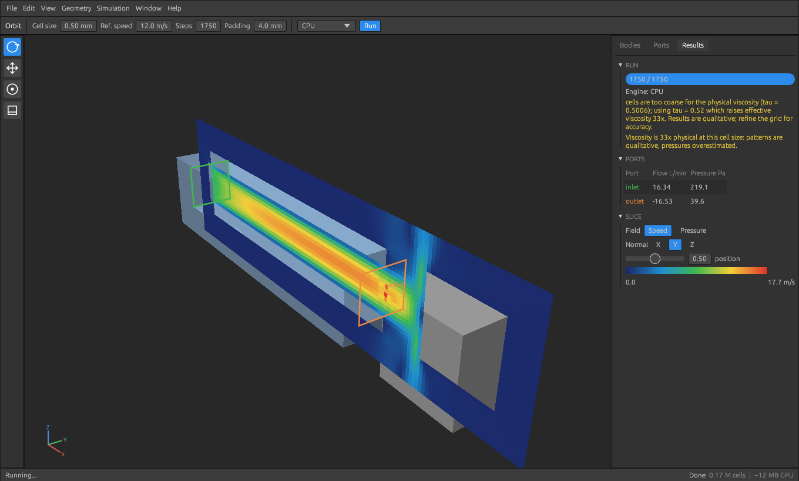

# Peregrine CFD

Airflow simulation for 3D-printer part-cooling ducts, written in Rust.

- Import a STEP assembly (a duct or a whole toolhead) or STL files. Bodies are found by name
  (`duct`, `duct_1`, `duct_L`, `duct_R`, ...; editable regex rules).
- Ducts are hollow solids. Their openings are detected automatically. Define one or more **sources** (a fan from
  the built-in library or your own curve, a total flow, or a mean speed), then **right-click an opening** in the
  3D view to assign it to a source (as an inlet) or make it a pressure outlet.
- A source can feed several openings (one fan over a hole that splits four ways). Choose how it is shared:
  by cross-section (flow proportional to each opening's area), by manual weights, or as a shared plenum
  pressure where the flow divides by each duct's resistance.
- Flow trajectories (streamlines) seeded from each source's inlets, with a per-source line count, colouring by
  speed or source, and a Shaded / Ghost / Hidden mesh mode (key `M`) to see only the flow.
- Small round holes (screw holes) are hidden from the opening list by default (adjustable diameter).
- GPU lattice-Boltzmann solver (wgpu: DX12 / Vulkan / Metal) with a CPU fallback. Velocity and pressure only.
- Tabs: each tab is an independent simulation (own geometry, ports, settings and run). Runs keep going in
  background tabs; `Ctrl+T` new, `Ctrl+W` close, `Ctrl+Tab` next, and File > Duplicate This Tab to compare variants.
- Photoshop-style dark UI with slice views, port report and VTK export.

See `docs/BUILD.md` to build and `docs/PLAN.md` for the design and status.

Accuracy: at coarse cell sizes the solver adds artificial viscosity to stay stable and says so. Flow patterns
are usable; absolute pressure drops are only trustworthy when the report shows no viscosity warning.

## Fan library

`peregrine fans` (or **+ Fan** in the Ports tab) lists the built-in fans: Sunon 5015 blowers, Delta 5015/4028,
WS7040, 4010 blower and axial, 2510 axial, 50x15 axial. Each curve is generated from the fan's maximum static
pressure and maximum free-air flow (distributor/datasheet listings), not from a measured curve. Entries marked
*estimate* have no datasheet figure behind them (Delta 4028, WS7040 flow, 4010 blower, Delta 5015 pressure):
the app warns when you use one. Replace them with your fan's datasheet or measured values.
