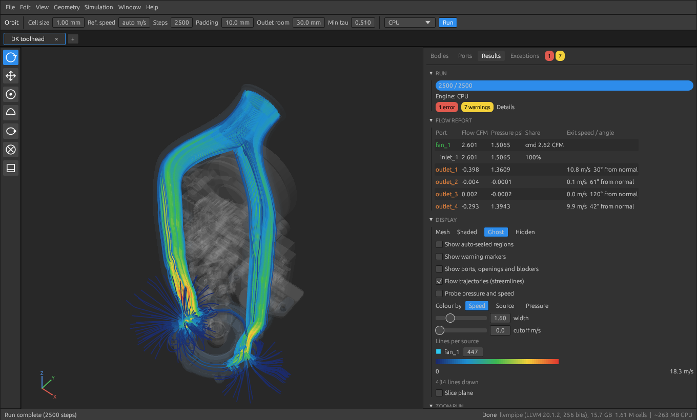
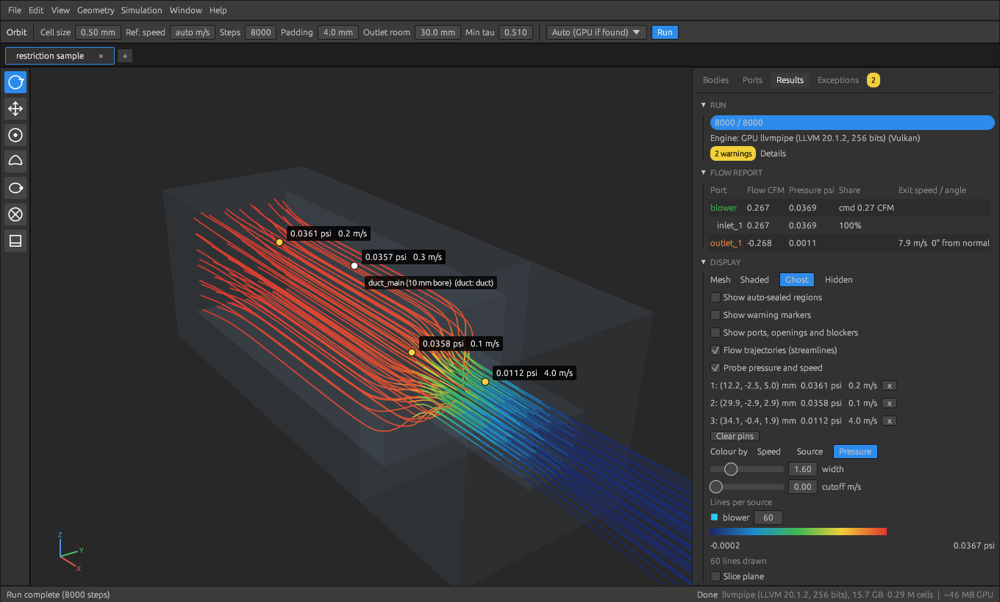

# Peregrine CFD

Airflow simulation for 3D-printer part-cooling ducts, written in Rust.

## What it does

- **Import a whole toolhead.** Open a STEP assembly (or STL files). A STEP product holding several solids is
  split into one part per solid. **You** decide which parts are the duct: click them in the 3D view or the Bodies
  list (Ctrl-click for several) and press *Define as duct*. Part names only highlight likely ducts ("duct",
  "shroud", "scoop"), they decide nothing. Hide parts with the eye icon or `V`.
- **Automatic opening detection.** Flat openings are found exactly, curved and scooped ones from the shape of the
  wall, and openings that merely continue down a tube are ignored. Select an opening by clicking its outline.
  Anything missed can be added with the **Curved Opening** tool (`R`) or traced by hand with **Draw Loop** (`L`).
- **Sources and ports.** A source is a fan (built-in library including the WS7040, WS9290 and WS9290B blowers, or your
  own curve), a total flow, or a mean speed. Right-click an opening to make it an inlet or a pressure outlet. One
  source can feed several openings, shared by cross-section, by manual weights, or as a shared plenum pressure.
  The fan is solved against the duct, so a restrictive duct really does choke it: less flow, more pressure.
- **Blockers.** Screw holes and unused vents are closed with the **Blocker** tool (`B`) or a hand-drawn loop.
- **Seam and leak handling.** Tiny gaps between touching parts are sealed automatically (and listed so you can
  review them); gaps over 1 mm or 2 mm² are treated as real and reported. Leaks, starved outlets and major flow
  restrictions show up in the **Exceptions** tab with severity chips, and each one that points at a place has a
  clickable marker in the 3D view.
- **Results you can read.**
  - Flow trajectories coloured by **speed, source or pressure**, with a cutoff that hides the slow tail.
  - A **probe**: hover anywhere inside the duct to read pressure and speed there, click to pin readings.
  - Slice planes for speed or pressure, and a per-port report of flow, pressure, exit speed and exit angle.
  - Flow is shown in **CFM** and pressure in **psi**.
- **Zoom runs.** Re-run a small box of the model at a much finer cell size, fed by the whole-duct result, to
  resolve slots and thin walls without needing a huge grid.
- **Fast.** The lattice-Boltzmann solver runs on the GPU (wgpu: DX12 / Vulkan / Metal) with a CPU fallback, the
  app reports your card and its memory and warns before a grid would not fit, and the 3D view is drawn on the GPU
  with flat shading.
- **Comfortable.** Undo and redo (`Ctrl+Z`, `Ctrl+Shift+Z`), independent simulation tabs that keep running in the
  background (`Ctrl+T`, `Ctrl+W`, File > Duplicate This Tab to compare variants), a first-run tutorial, and a
  Photoshop-style dark UI.

## A real example: a toolhead duct with four outlets

A twin-outlet part-cooling duct from a direct-drive toolhead, imported straight from its STEP file. One 24 V blower
feeds one inlet; the air splits into two kidney-shaped slots and two ring halves around the nozzle. Screw holes
are blocked, and the run shows which outlets actually get air.

*The toolhead duct after a 1 mm, 2,500-step run: streamlines coloured by speed, fastest through the narrow slots.
(A short run for the picture; run longer for settled numbers.)*

## Pressure and the probe

Choke a fan and the pressure builds up behind the restriction while the flow drops. **File > Load Restriction
Sample** loads a 10 mm duct narrowing to a 4 mm exit, fed by a small blower. Colour the streamlines by *Pressure*
and turn on *Probe pressure and speed*: hover anywhere inside the duct to read the pressure and air speed there, and
click to pin readings. Here the pressure is 0.036 psi in the wide section and only 0.011 psi inside the narrow
exit, where the air moves at 4 m/s.

The other built-in samples are **File > Load Demo** and **Help > Run tutorial**.

## Interface

See `docs/BUILD.md` to build and `docs/PLAN.md` for the design and status.

Accuracy: at coarse cell sizes the solver adds artificial viscosity to stay stable and says so. Flow patterns
are usable; absolute pressure drops are only trustworthy when the report shows no viscosity warning.

## Fan library

`peregrine fans` (or **+ Fan** in the Ports tab) lists the built-in fans: Sunon 5015 blowers, Delta 5015/4028,
WS7040, WS9290 and WS9290B blowers (from their spec sheets), 4010 blower and axial, 2510 axial, 50x15 axial. Each curve is generated from the fan's maximum static
pressure and maximum free-air flow (distributor/datasheet listings), not from a measured curve. Entries marked
*estimate* have no datasheet figure behind them (Delta 4028, WS7040 flow, 4010 blower, Delta 5015 pressure):
the app warns when you use one. Replace them with your fan's datasheet or measured values.

## First run

On first launch Peregrine opens a built-in tutorial with a sample duct that walks through every major feature (duct definition, sources, ports, curved openings, blockers, undo, running, streamlines, exceptions). Use **Skip tutorial** to leave it, and **Help > Run tutorial** to start it again.
